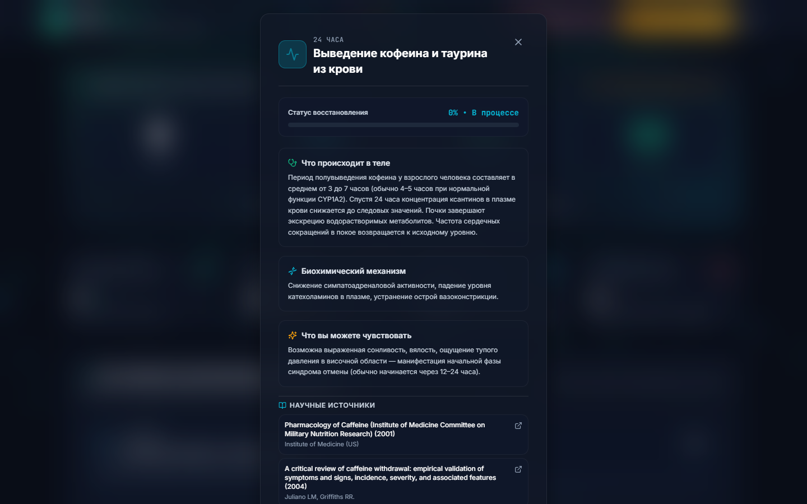
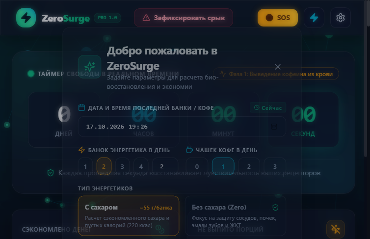

# ZeroSurge PRO ⚡

[](https://react.dev/)
[](https://www.typescriptlang.org/)
[](https://vitejs.dev/)
[](https://tailwindcss.com/)
[](https://www.electronjs.org/)
[](https://vitest.dev/)
[](LICENSE)
[-success.svg)](#безопасность-и-приватность)

<p align="left">
  <a href="https://github.com/poxmolodoy/zerosurge/releases/download/v1.0.0/ZeroSurge-1.0-Portable.exe">
    
  </a>
  <a href="https://github.com/poxmolodoy/zerosurge/releases/tag/v1.0.0">
    
  </a>
</p>

Автономный информационно-просветительский трекер для преодоления зависимости от энергетических напитков и высоких доз кофеина. Доступен как в веб-версии, так и в виде портативного Windows-приложения (`ZeroSurge-1.0-Portable.exe`).

Никаких облаков, подписок, рекламы или сбора личных данных. Все вычисления, история чек-инов и таймеры работают исключительно на вашем устройстве.

---

## 📸 Интерфейс и возможности

### 1. Главный экран и шкала био-восстановления
Таймер свободы в реальном времени с точностью до секунды, счетчик сэкономленных денег, предотвращенных граммов сахара и интерактивные карточки физиологической регенерации органов:


### 2. Верхняя панель быстрого доступа
Лаконичный доступ к ключевым инструментам: календарь срывов, клинический атлас вреда, система ачивок, кнопка экстренной помощи SOS и переключатель энергосбережения:


### 3. Атлас патологий: системное воздействие стимуляторов
Карта воздействия кофеина, таурина и сахара на 6 систем организма (сердечно-сосудистая, нервная, эндокринная, ЖКТ, почки, зубная эмаль) с прямыми ссылками на PubMed и DOI:


### 4. Карточка доказательной медицины (Frosted Modal)
При клике на любую систему открывается детальный разбор: биохимический механизм (активация адренорецепторов, блокада фосфодиэстеразы, накопление цАМФ), клинические симптомы интоксикации, ориентировочные сроки восстановления и кликабельный блок научных публикаций:


### 5. Детализация био-прогресса по дням
Каждый этап отказа сопровождается фармакокинетическим объяснением со ссылками на исследования: клиренс метаболитов, адаптация церебрального кровотока и нормализация аденозиновых рецепторов A1/A2A:



### 6. Энергосберегающий режим (Eco Mode)
Отключение интерактивных Canvas-частиц нейронной сети в один клик. Идеально для слабых ноутбуков или экономии заряда батареи:



---

## 🔬 Физиология и стимуляторы (Без морализаторства)

Большинство трекеров привычек считают «дни без привычки» и показывают абстрактные цитаты. В случае стимуляторов важна биохимия:

1. **Комплексный синергетический состав:** В банке энергетика содержится не просто кофеин (150–320 мг), а его синергия с таурином (до 1000 мг), глюкуронолактоном и сахаром (~55 г на 0.5 л, что превышает базовую суточную рекомендацию ВОЗ в 50 г и более чем вдвое выше целевого ориентира 25 г).
2. **Ап-регуляция аденозина:** Кофеин не дает энергии — он лишь временно блокирует рецепторы усталости ($A_1$ и $A_{2A}$). В ответ мозг увеличивает плотность рецепторов (up-regulation), формируя толерантность и синдром отмены при прекращении приема.
3. **Стимуляция HPA-оси и сосудистый спазм:** Активация симпатоадреналовой системы повышает артериальное давление в острой фазе и сокращает фазу глубокого сна (NREM). В доказательной медицине псевдодиагноз «истощение надпочечников» отвергнут — речь идет о функциональной перегрузке нейроэндокринной регуляции.

**ZeroSurge** опирается на проверяемые исследования (Juliano & Griffiths 2004, JAHA 2019, ВОЗ 2015): пик синдрома отмены приходится на 20–51 час (1–2 сутки), а к 3–4 дню острые проявления стихают. Полный научный реестр опубликован в [docs/CONTENT_REVIEW.md](docs/CONTENT_REVIEW.md).

---

## ⚡ Ключевые возможности

- ⏱ **Честный таймер без рассинхронизации:** В десктопной сборке отключено троттление фоновых таймеров Chromium (`backgroundThrottling: false`). Время не "замерзает" при сворачивании окна.
- 💰 **Калькулятор спасенных ресурсов:** Точный расчет бюджета, невыпитых банок/чашек и граммов сахара (с отдельным режимом для напитков "Zero Sugar").
- 🚨 **Режим экстренной помощи SOS:** 
  - **Квадратное дыхание (Box Breathing 4-4-4-4):** Анимированный визуальный круг с тактильным ритмом для экстренного снижения пульса и подавления симпатического криза.
  - **Техника серфинга тяги (Urge Surfing):** Пошаговая нейропсихологическая практика осознания компульсивного позыва без перехода к действию.
- 📉 **Справедливая система штрафов за срыв (Fair Relapse Penalty):** Ошибка не обнуляет весь накопленный физиологический прогресс до 0. Алгоритм вычитает штрафные часы пропорционально длительности чистого периода, предотвращая эффект «какого черта» (*abstinence violation effect*).
- 📊 **Дневник самочувствия и научная модель:** Фиксация уровня энергии, качества сна и интенсивности тяги по дням с наложением эталонной кривой нейроадаптации.
- 🏆 **Система достижений:** От первых 24 часов очистки крови до года чистых рецепторов и сбережения десятков тысяч рублей.
- 🎨 **Интерактивный фон на 60 FPS:** Физическая симуляция нейросетевых связей на Canvas с реакцией на курсор и автоматической заморозкой при неактивной вкладке (`document.hidden`).

---

## 🛡️ Безопасность и приватность

Приложение построено по архитектуре **Zero-Knowledge Client-Side Only**:

| Параметр | Реализация в ZeroSurge |
|---|---|
| **Сбор данных** | **0 байт.** Никакой телеметрии, Google Analytics или сторонних пикселей |
| **Хранение данных** | Локально в браузере / Electron (`localStorage`) |
| **Защита от инъекций** | Полное отсутствие `dangerouslySetInnerHTML`, `eval()` и динамического DOM-парсинга |
| **Защита хранилища** | Модуль `securityValidator.ts`: очистка prototype pollution, валидация типов и жесткий bounds clamping диапазонов |
| **Изоляция Electron** | `contextIsolation: true`, `nodeIntegration: false`, изоляция через `preload.cjs` |
| **Внешние ссылки** | Перехват `setWindowOpenHandler`: внешние статьи открываются исключительно в системном браузере ОС |
| **Runtime-уязвимости** | `npm audit --omit=dev` — **0 уязвимостей** |

Подробный отчет доступен в файле [SECURITY.md](SECURITY.md).

---

## 📦 Скачивание и запуск Portable-версии для Windows

Вы можете использовать готовый скомпилированный бинарник без установки Node.js:

1. Скачайте файл **[ZeroSurge-1.0-Portable.exe](https://github.com/poxmolodoy/zerosurge/releases/download/v1.0.0/ZeroSurge-1.0-Portable.exe)** и файл контрольных сумм **`SHA256SUMS.txt`** из раздела [Releases](https://github.com/poxmolodoy/zerosurge/releases/tag/v1.0.0).
2. Запустите файл двойным кликом.
3. Программа **не требует инсталляции**, не оставляет следов в системном реестре Windows и может запускаться прямо с USB-накопителя.
4. Все сохраненные данные привязаны к локальному профилю пользователя.

### 🔒 Проверка целостности и Windows SmartScreen

#### Проверка контрольной суммы SHA-256
Каждый релиз собирается автоматически в изолированном окружении [GitHub Actions Workflow](.github/workflows/release.yml). Чтобы убедиться, что скачанный файл не был повреждён или подменён, рассчитайте его хэш-сумму:

- **PowerShell (Windows):**
  ```powershell
  Get-FileHash .\ZeroSurge-1.0-Portable.exe -Algorithm SHA256
  ```
- **Linux / macOS / Git Bash:**
  ```bash
  sha256sum -c SHA256SUMS.txt
  ```
Сравните полученную строку со значением в файле `SHA256SUMS.txt` на странице релиза.

#### Предупреждение Windows SmartScreen
Исполняемый файл является бесплатным проектом с открытым исходным кодом и **не имеет коммерческого платного сертификата Authenticode**. Поэтому при первом запуске Windows Defender SmartScreen может показать окно «Система Windows защитила ваш компьютер».
- Для продолжения нажмите **«Подробнее» (More info) → «Выполнить в любом случае» (Run anyway)**.
- Вы можете полностью проинспектировать исходный код и процесс сборки в [.github/workflows/release.yml](.github/workflows/release.yml).

---

## 🛠️ Сборка и запуск из исходного кода

### Требования
- **Node.js** версии 18.0 или новее
- **npm** версии 9.0 или новее

### 1. Клонирование и установка зависимостей
```bash
git clone https://github.com/poxmolodoy/zerosurge.git
cd zerosurge
npm install
```

### 2. Запуск в режиме веб-разработки
```bash
npm run dev
```
Приложение откроется по адресу `http://localhost:5173`.

### 3. Запуск десктопного приложения в режиме разработки
```bash
# В первом терминале (сервер Vite):
npm run dev

# Во втором терминале (запуск Electron окна):
npm run electron:start
```

### 4. Запуск автоматических тестов
```bash
npm test
```
Будут выполнены все 78 интеграционных и модульных тестов Vitest.

### 5. Сборка веб-бандла для продакшена
```bash
npm run build
```
Статические файлы будут скомпилированы в директорию `dist/`.

### 6. Сборка автономного Windows Portable `.exe`
```bash
npm run electron:build:portable
```
Скрипт выполнит проверку типов TypeScript, сборку клиентского бандла и упаковку через `electron-builder`. Готовый исполняемый файл будет сгенерирован в папке:
```
release/ZeroSurge-1.0-Portable.exe
```

---

## 📂 Структура проекта

```text
zero-surge/
├── dist/                      # Скомпилированный статический веб-бандл
├── docs/                      # Документация и скриншоты для GitHub
│   └── images/                # Графика высокого разрешения
├── electron/                  # Изолированный главный процесс Electron
│   ├── main.cjs               # Настройки окна, IPC, защита ссылок, single instance
│   └── preload.cjs            # Безопасный изоляционный мост (contextBridge)
├── release/                   # Директория скомпилированного Portable .exe
├── src/
│   ├── components/            # Модульные компоненты интерфейса
│   │   ├── AchievementsModal.tsx     # Модальное окно ачивок
│   │   ├── CaffeineHarmAtlasModal.tsx# Атлас вреда для органов
│   │   ├── CaffeineHarmGrid.tsx      # Сетка карточек систем органов
│   │   ├── EmergencyModal.tsx        # SOS: Box Breathing и Urge Surfing
│   │   ├── FeelingChart.tsx          # График энергии, сна и тяги
│   │   ├── HarmDetailModal.tsx       # Клиническое окно патологии органа
│   │   ├── Header.tsx                # Навигация, порядок иконок, Eco toggle
│   │   ├── HealthJournalModal.tsx    # Интерактивный календарь и дневник
│   │   ├── MilestoneDetailModal.tsx  # Разбор фазы восстановления
│   │   ├── NeuralBackground.tsx      # Canvas-фон нейросети 60 FPS
│   │   ├── OnboardingModal.tsx       # Стартовая настройка привычки
│   │   └── RelapseModal.tsx          # Диалог срыва со справедливым штрафом
│   ├── data/                  # Клинические справочники и константы
│   ├── hooks/                 # Пользовательские React-хуки (таймер, режим эко)
│   └── utils/                 # Математические расчеты и валидатор безопасности
├── SECURITY.md                # Полный аудит безопасности и Threat Model
├── REPORT.md                  # Подробный технический отчет о разработке
├── package.json
├── tailwind.config.js
└── vite.config.ts
```

---

## 📄 Лицензия и отказ от ответственности

- Проект распространяется под открытой лицензией **MIT**. Подробности в файле [LICENSE](LICENSE).
- **Медицинский дисклеймер:** ZeroSurge носит информационно-просветительский характер и опирается на открытые клинические данные о фармакокинетике кофеина и таурина. При наличии серьезных сердечно-сосудистых заболеваний, аритмии или выраженного абстинентного синдрома обязательно проконсультируйтесь с лечащим врачом.
