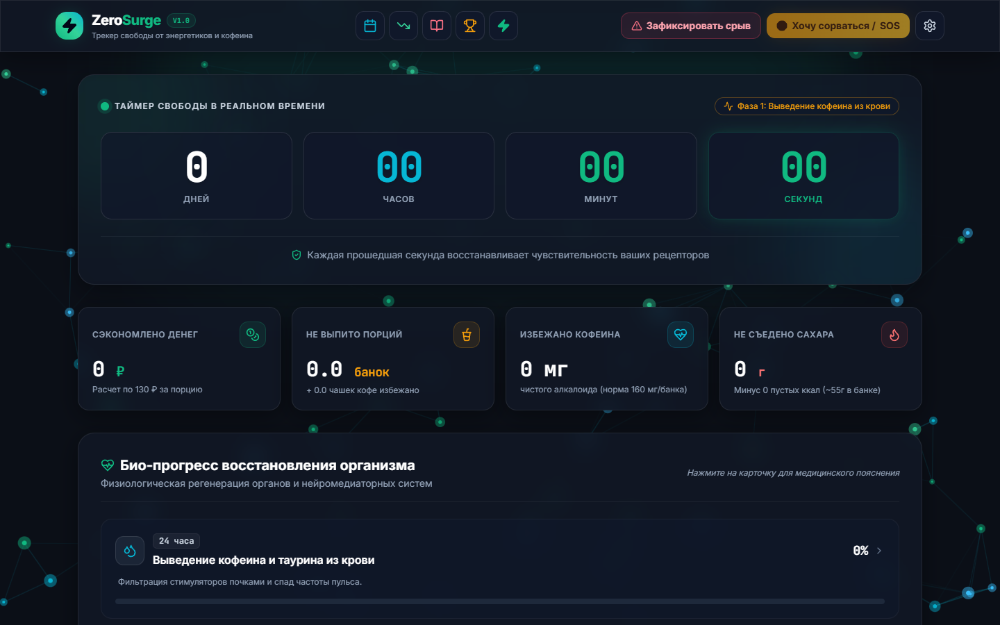
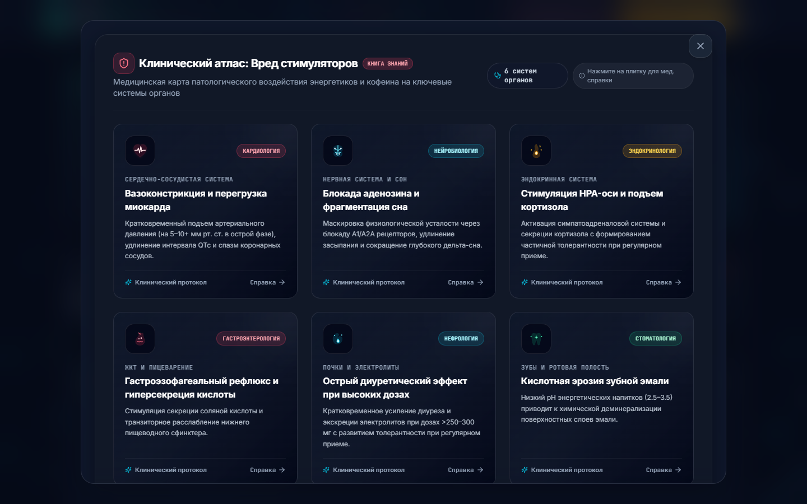
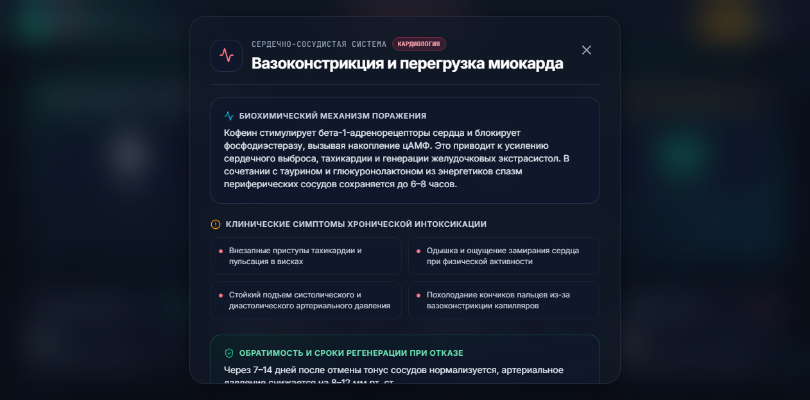

# ZeroSurge ⚡

[](https://react.dev/)
[](https://www.typescriptlang.org/)
[](https://vitejs.dev/)
[](https://tailwindcss.com/)
[](https://poxmolodoy.github.io/zerosurge/)
[](https://github.com/poxmolodoy/zerosurge/actions/workflows/ci.yml)
[](LICENSE)
[](#безопасность-и-приватность)

🌐 **[English Documentation (README.en.md)](README.en.md)**

<p align="left">
  <a href="https://poxmolodoy.github.io/zerosurge/">
    
  </a>
</p>

Автономное доказательное прогрессивное веб-приложение (PWA) для преодоления зависимости от энергетических напитков и высоких доз кофеина. Работает на любых устройствах (смартфоны, планшеты, ПК) прямо в браузере или в виде установленного на экран приложения.

Никаких серверов, облаков, подписок, рекламы или сбора личных данных. Все вычисления, дневники и таймеры сохраняются исключительно на вашем устройстве в `localStorage`. Благодаря встроенному Service Worker приложение доступно и полностью работоспособно даже при полном отсутствии интернета.

---

## 📸 Интерфейс и ключевые возможности

### 1. Главный экран и шкала био-восстановления

Таймер свободы в реальном времени с точностью до секунды, счетчик сэкономленных денег, предотвращенных граммов сахара и интерактивные карточки физиологической регенерации органов:



### 2. Верхняя панель быстрого доступа

Лаконичный доступ к ключевым инструментам: календарь срывов, клинический атлас вреда, журнал потребления, программа снижения (Tapering), система ачивок, кнопка экстренной помощи SOS и переключатель энергосбережения:


### 3. Интерактивный Атлас вреда кофеина и этапы регенерации

Детальный разбор воздействия высоких доз кофеина, таурина и сахара на 6 систем организма с прямыми ссылками на рецензируемые медицинские исследования (PubMed, DOI, ВОЗ):





---

## 📱 Установка как приложение (PWA)

ZeroSurge можно установить в один клик без сторонних магазинов приложений — оно будет открываться в отдельном окне без адресной строки браузера и работать полностью офлайн:

- **iOS (iPhone / iPad):**
  1. Откройте [https://poxmolodoy.github.io/zerosurge/](https://poxmolodoy.github.io/zerosurge/) в браузере Safari.
  2. Нажмите кнопку **«Поделиться»** (иконка квадрата со стрелкой вверх внизу экрана).
  3. Выберите пункт **«На экран "Домой"»** (Add to Home Screen).
- **Android:**
  1. Откройте сайт в Google Chrome.
  2. Во всплывающей плашке или в меню (три точки) нажмите **«Установить приложение»**.
- **Windows / macOS / Linux (Chrome, Edge, Brave):**
  1. Откройте сайт в браузере.
  2. Нажмите на иконку монитора со стрелкой **«Установить ZeroSurge»** в правой части адресной строки.

---

## 🔬 Доказательная медицина и методология

В отличие от развлекательных трекеров привычек, архитектура и контент ZeroSurge построены на строгих фармакокинетических моделях и клинических исследованиях:

1. **Фармакокинетика кофеина:** Учитывается период полувыведения $T_{1/2} = 3\text{--}7$ часов, связывание с аденозиновыми рецепторами $A_1$ и $A_{2A}$, временная шкала абстиненции (12–24 ч начало, 20–51 ч пик по Juliano & Griffiths, 2004).
2. **Алгоритм справедливого штрафа при срыве:** В традиционных счетчиках срыв сбрасывает весь многомесячный прогресс в ноль, провоцируя психологический эффект нарушения воздержания (_Abstinence Violation Effect_). В ZeroSurge срыв уменьшает чистое время пропорционально логарифмической кривой нейроадаптации, сохраняя накопленную физиологическую регенерацию.
3. **Программа постепенного снижения (Tapering):** Для пользователей с высокими суточными дозами предусмотрен режим плавного сокращения дозы на 14–42 дня с расчетом безопасного суточного лимита.
4. **Инструменты купирования острой тяги (SOS):**
   - **Box Breathing (4-4-4-4):** Дыхательный метроном для снижения частоты сердечных сокращений и активации парасимпатической нервной системы (блуждающего нерва).
   - **Urge Surfing (Марлати):** Протокол осознанного наблюдения за физическими маркерами тяги без волевого подавления.

Полный научный реестр со ссылками на PubMed, DOI и рекомендации ВОЗ задокументирован в [docs/CONTENT_REVIEW.md](docs/CONTENT_REVIEW.md).

---

## 🛡️ Безопасность и приватность (Local-only)

ZeroSurge реализует строгую модель **Local-only Architecture**:

- **0 байт исходящего трафика:** В приложении отсутствуют Google Analytics, Яндекс.Метрика, Sentry, сторонние логгеры или телеметрия.
- **Строгая политика CSP:** `default-src 'self'; script-src 'self'; style-src 'self' 'unsafe-inline'; font-src 'self' data:; img-src 'self' data:; connect-src 'self';` запрещает любые внешние сетевые запросы.
- **Локальные шрифты:** Гарнитуры Inter и JetBrains Mono поставляются локально внутри веб-бандла (лицензия OFL).
- **Безопасный экспорт и импорт:** Резервная копия сохраняется в файл JSON. При импорте данные проходят строгую санитизацию против Prototype Pollution (`__proto__`, `constructor`), проверку диапазонов и дат (`src/utils/securityValidator.ts`).
- **Автоматизированная проверка:** Команда `npm run check:offline` в CI сканирует готовый бандл и гарантирует отсутствие внешних сетевых ссылок.

Подробная модель угроз описана в [docs/threat-model.md](docs/threat-model.md), а политика сообщений об уязвимостях — в [SECURITY.md](SECURITY.md).

---

## 🛠️ Разработка и локальный запуск

### Требования

- Node.js 18.0 или новее
- npm 9.0 или новее

### 1. Клонирование репозитория

```bash
git clone https://github.com/poxmolodoy/zerosurge.git
cd zerosurge
```

### 2. Установка зависимостей

```bash
npm ci
```

### 3. Запуск сервера разработки

```bash
npm run dev
```

Локальный сервер запустится по адресу `http://localhost:5173/`.

### 4. Запуск автоматических тестов

```bash
npm test
```

Будут выполнены все 107 интеграционных и модульных тестов Vitest.

### 5. Сборка для продакшена

```bash
npm run build
```

Статические файлы приложения и Service Worker будут скомпилированы в директорию `dist/`.

### 6. Проверка офлайн-целостности

```bash
npm run check:offline
```

---

## 📂 Структура проекта

```text
zerosurge/
├── .github/                   # CI/CD автоматизация (GitHub Actions: тесты, линтер, Pages)
├── dist/                      # Скомпилированный статический веб-бандл
├── docs/                      # Документация, скриншоты и научные реестры
│   ├── CONTENT_REVIEW.md      # Клинический реестр исследований и источников
│   ├── threat-model.md        # Модель угроз локального веб-приложения
│   ├── FONTS_LICENSE.md       # Лицензии встроенных шрифтов (OFL)
│   └── images/                # Графика высокого разрешения для GitHub
├── public/                    # Статические ассеты (favicon.svg, иконки)
├── scripts/                   # Утилиты аудита (проверка офлайн-целостности check-offline.js)
├── src/                       # Исходный код React / TypeScript
│   ├── components/            # Модульные компоненты интерфейса (модалки, дашборд, графики)
│   ├── data/                  # Клинические справочники и проверенные источники
│   ├── hooks/                 # Пользовательские React-хуки (таймер, режим эко)
│   └── utils/                 # Математические расчеты, экспорт/импорт и валидатор
├── CHANGELOG.md               # История версий (Keep a Changelog)
├── CONTRIBUTING.md            # Руководство для контрибьюторов
├── SECURITY.md                # Политика сообщения об уязвимостях
├── README.md                  # Документация на русском языке
├── README.en.md               # Документация на английском языке
├── package.json
├── tailwind.config.js
└── vite.config.ts
```

---

## 📬 Автор и контакты

- **Автор проекта:** [@poxmolodoy](https://github.com/poxmolodoy)
- **Email для связи и предложений:** [dima.dima.shift3@gmail.com](mailto:dima.dima.shift3@gmail.com)
- **Баг-трекер и фич-реквесты:** [GitHub Issues](https://github.com/poxmolodoy/zerosurge/issues)

---

## 📄 Лицензия и отказ от ответственности

- Проект распространяется под открытой лицензией **MIT**. Подробности в файле [LICENSE](LICENSE).
- **Медицинский дисклеймер:** ZeroSurge носит информационно-просветительский характер и опирается на открытые клинические данные о фармакокинетике кофеина и таурина. При наличии серьезных сердечно-сосудистых заболеваний, аритмии или выраженного абстинентного синдрома обязательно проконсультируйтесь с лечащим врачом.
